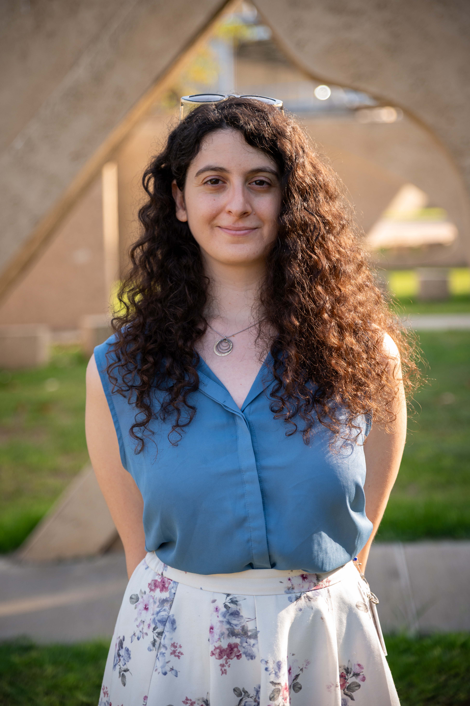

.primary-accent {
    color: #d97706; /* e.g., an amber/orange tone */
}

.secondary-accent {
    color: #059669; /* e.g., a green tone */
}

# Nila Theodor B.Sc.

## About
I'm a Chemistry M.Sc. student in at the Material science department, Weizmann Institute.
Currently under joint guidance of Prof. Meir Lahav and Prof. Igor Lubomirski.
In my research, I study electric properties of organic crystals designed through crystal engineering. 
I'm interested in the interaction of materials with light and electricity.

## My Goals
I want to create catalog for the materials found in our lab with easy search and submission of new materials. (with automated logging of date received).

## Education

### Dual Degree in Chemistry &amp; Chemical Engineering, Ben Gurion University of the Negev, 2020 - 2025
  An Excellence program that specializes in Nanotechnology. 
- Chemical Engineering GPA: 84, Chemistry GPA: 91.
- Chemical Engineering final project in separation of heavy metals from sewage.

### Pre-Academic Program for Engineering and Science Degrees Technion – Israel Institute of Technology, 2019-2020
A program that provides academic tools and knowledge in physics and mathematics in order to prepare for higher education in engineering and science. Graduated with distinction. GPA: 92

## Experience 

### Research Assistant in Nanotribology Lab, Ben Gurion University of the Negev 2024 – 2025
- Research and lab work in Nanotribology field- atomic friction, in Prof. Ronen Berkovich’s lab.
- Analyzing AFM friction maps and extracting physical data using MATLAB.
- Participated in research involving international collaboration.
- Contributed to the analysis and interpretation of research findings, providing valuable insights that shaped the direction of the project.

### Research Assistant in Organic Biomineralization & Biological Photonics lab, Ben Gurion University of the Negev 2024 – 2025
- Research and lab work in Optically Functional Organic Bio-Crystals, in Dr. Benjamin Palmer’s lab.
- Wet lab work with organic materials, executing experiments according to scientific protocols, analyzing results and drawing conclusions.
- Sample preparation and component identification using TLC and LCMS.

## Professional Skills
Programing languages: MATLAB
proficient in Microsoft Office
Experienced in organic chemistry, advanced physical chemistry and chemical engineering labs.
Highly skilled in academic and engineering writing in English and Hebrew.
